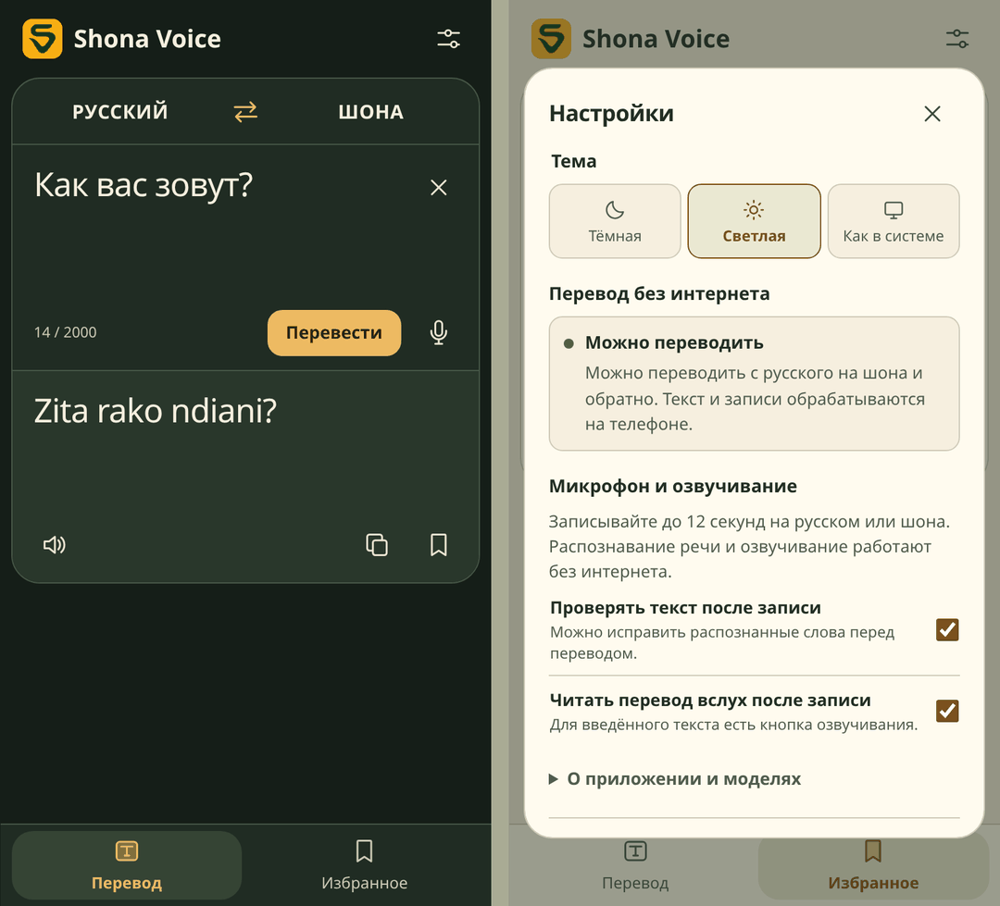

<h1 align="center">
  
</h1>

**Карманный переводчик с русского на шона и обратно.** Можно написать фразу или произнести её, проверить распознанный текст и услышать перевод. Всё работает на телефоне, в том числе в авиарежиме.

  
   
  Версия 1.0.0 · Android 8.0+ · ARM64

## Установка

1. Скачайте **ShonaVoice-Offline.apk** на телефон и откройте его. Если Android запросит разрешение на установку из этого источника, разрешите её для приложения, из которого открыли файл.
2. Запустите **Shona Voice**. При первом запуске приложение распакует и проверит встроенные модели. Для моделей и кеша перевода потребуется ещё **2,60 ГБ** после установки.
3. Выберите направление, введите фразу и нажмите **Перевести**. Для голосового ввода нажмите микрофон и разрешите доступ к нему.

Интернет нужен только для скачивания APK. Все модели перевода, распознавания и оба голоса уже внутри. [Страница релиза и контрольная сумма файла](https://github.com/isarnavskiy/ShonaVoice/releases/tag/v1.0.0)

## Как выглядит приложение

  

| Что можно сделать | Как это работает |
| --- | --- |
| Перевести текст | Русский → шона и шона → русский. До 2 000 символов за один раз. |
| Перевести речь | Запишите до 12 секунд. Распознанную фразу можно исправить перед переводом. |
| Послушать результат | Нажмите динамик или включите автоматическое чтение после голосового ввода. Русский голос и голос шона встроены. |
| Сохранить удачный перевод | Нажмите закладку. Сохранённые пары доступны в «Избранном», где работает поиск на обоих языках. |
| Настроить внешний вид | В настройках доступны светлая, тёмная и системная темы. Там же отображается готовность моделей. |

## Для разработчиков

Android-приложение написано на Kotlin и Java. Локальный интерфейс открывается в WebView, а модели выполняются через ONNX Runtime. Файлы весов в поставляемом приложении занимают 2,09 ГБ до сжатия. Сборка `:app:assembleDebug` проверена с полным комплектом моделей.

| Материал | Что внутри |
| --- | --- |
| [Сборка из исходников](docs/BUILD.md) | Подготовка моделей, сборка APK и установка тестовой версии. |
| [Модели и результаты проверок](docs/MODELS.md) | Происхождение моделей, лицензии, примеры перевода и ограничения качества. |
| [Исходный код приложения](app/src/main) | Перевод, голосовой ввод, озвучивание и интерфейс. |
| [Выпуски](https://github.com/isarnavskiy/ShonaVoice/releases) | Готовый APK для каждого опубликованного выпуска. |

Модели NLLB и MMS от Meta AI распространяются по **CC BY-NC 4.0** для некоммерческого использования. [Сведения об авторах и лицензиях](docs/MODELS.md)
