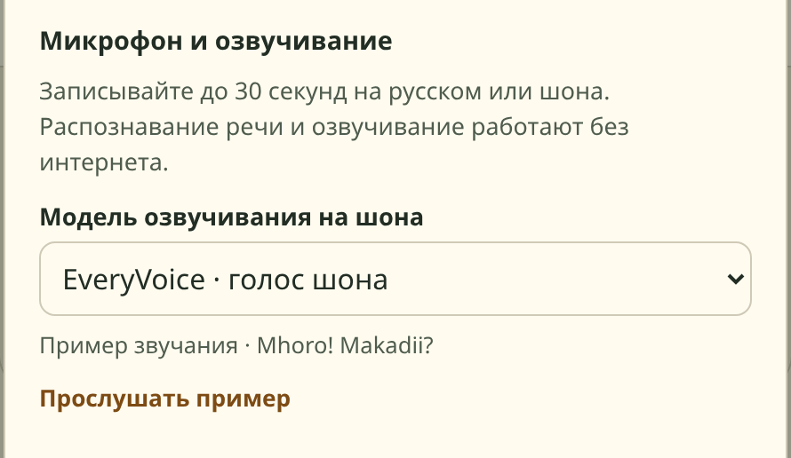

<h1 align="center">
  
</h1>

**Карманный переводчик с русского на шона и обратно.** Можно написать фразу или произнести её, проверить распознанный текст и услышать перевод. Всё работает на телефоне, в том числе в авиарежиме.

  
   
  Версия 1.0.3 · Android 8.0+ · ARM64

## Установка

1. Скачайте **ShonaVoice-Offline.apk** на телефон и откройте его. Если Android запросит разрешение на установку из этого источника, разрешите её для приложения, из которого открыли файл.
2. Запустите **Shona Voice**. При первом запуске приложение распакует и проверит встроенные модели. Для моделей и кеша перевода потребуется ещё **2,73 ГБ** после установки.
3. Выберите направление, введите фразу и нажмите **Перевести**. Для голосового ввода нажмите микрофон и разрешите доступ к нему.

Если уже установлена предыдущая версия Shona Voice из этого репозитория, откройте новый APK и выберите «Обновить».

Интернет нужен только для скачивания APK. В APK уже есть переводчик, распознавание, русский голос и два голоса шона. [Страница релиза и контрольная сумма файла](https://github.com/isarnavskiy/ShonaVoice/releases/latest)

В версии **1.0.3** исправлено воспроизведение EveryVoice на телефонах, где при нажатии на динамик появлялось «Invalid audio buffer size». Установите новый APK поверх старой версии.

## Как звучит шона

В **Настройки → Модель озвучивания на шона** можно выбрать голос и нажать **Прослушать пример**. Выбор сохраняется на телефоне. В этих двух записях голоса произносят одну фразу: *Zita rako ndiani? Ndinokutendai zvikuru.* («Как вас зовут? Большое спасибо»).

| Голос | Послушать |
| --- | --- |
| **EveryVoice**, 22,05 кГц. Выбран при первом запуске, учитывает регистр и знаки препинания. | [EveryVoice · WAV, 3,20 с](https://raw.githubusercontent.com/isarnavskiy/ShonaVoice/v1.0.2/docs/audio/everyvoice-shona.wav) |
| **MMS**, 16 кГц. Компактный голос с короткими паузами между частями фразы. | [MMS · WAV, 3,39 с](https://raw.githubusercontent.com/isarnavskiy/ShonaVoice/v1.0.2/docs/audio/mms-shona.wav) |

На 32 контрольных записях речи шона число ошибок распознавания снизилось со 107 до 93 на 404 слова. Для номеров с ведущими нулями, времени, адресов почты и ссылок добавлены отдельные проверки перевода. [Сравнение версий и ограничения проверки](docs/QUALITY-1.0.2.md)

## Как выглядит приложение

  

| Что можно сделать | Как это работает |
| --- | --- |
| Перевести текст | Русский → шона и шона → русский. До 2 000 символов за один раз. |
| Перевести речь | Запишите до 30 секунд. Запись можно остановить раньше. Распознанную фразу можно исправить перед переводом. |
| Послушать результат | Нажмите динамик или включите автоматическое чтение после голосового ввода. Для шона можно выбрать EveryVoice или MMS. |
| Сохранить удачный перевод | Нажмите закладку. Сохранённые пары доступны в «Избранном», где работает поиск на обоих языках. |
| Настроить внешний вид | В настройках доступны светлая, тёмная и системная темы. Там же отображается готовность моделей. |

## Для разработчиков

Android-приложение написано на Kotlin и Java. Локальный интерфейс открывается в WebView, а модели выполняются через ONNX Runtime. Файлы весов в поставляемом приложении занимают 2,21 ГБ до сжатия.

| Материал | Что внутри |
| --- | --- |
| [Сборка из исходников](docs/BUILD.md) | Подготовка моделей, сборка APK и установка тестовой версии. |
| [Модели и результаты проверок](docs/MODELS.md) | Происхождение моделей, лицензии, примеры перевода и ограничения качества. |
| [Исходный код приложения](app/src/main) | Перевод, голосовой ввод, озвучивание и интерфейс. |
| [Выпуски](https://github.com/isarnavskiy/ShonaVoice/releases) | Готовый APK для каждого опубликованного выпуска. |

Модели NLLB и MMS от Meta AI распространяются по **CC BY-NC 4.0** для некоммерческого использования. Голос EveryVoice OpenBible Shona и его ONNX-версия распространяются по **CC BY-SA 4.0**. [Сведения об авторах и лицензиях](docs/MODELS.md)
